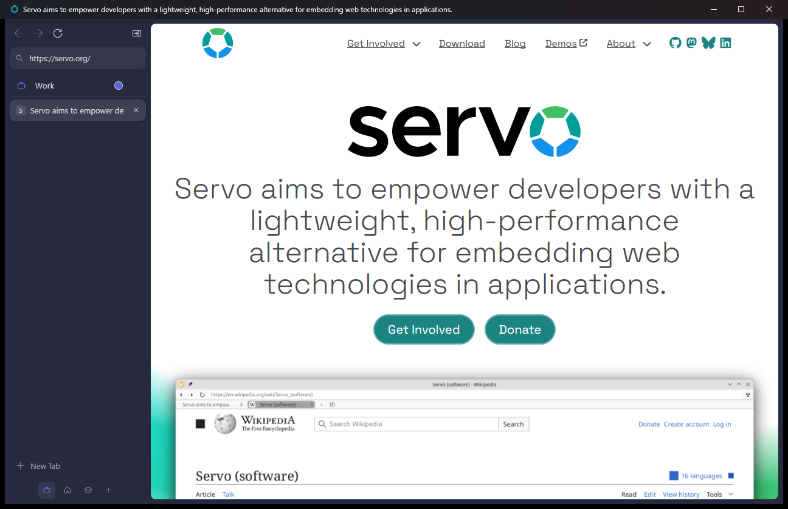
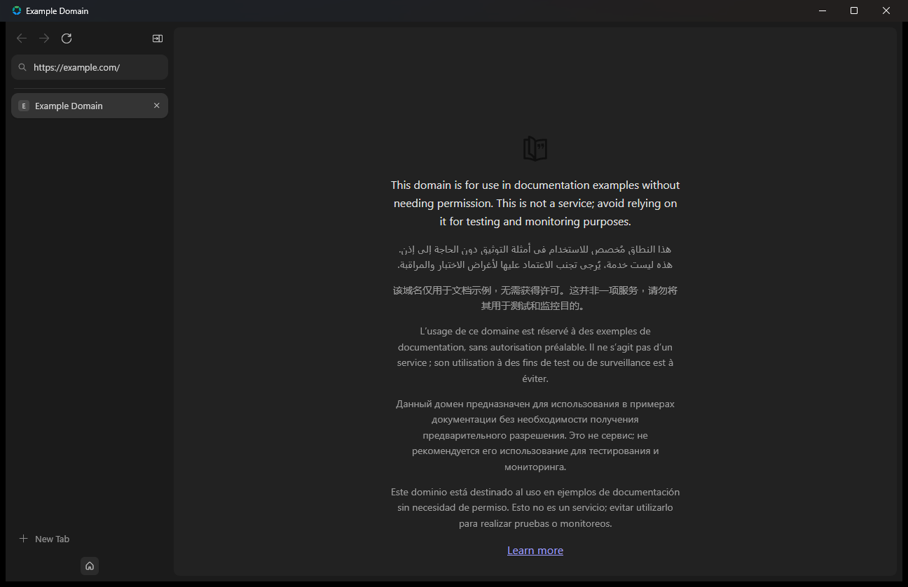

<div align="center">


# Stillwater

**A calm, lightweight browser built on [Servo](https://servo.org) — vertical tabs and workspaces, written in Rust.**

[Download for Windows](https://github.com/WhoaThatCombo/stillwater/releases) · [Website](https://whoathatcombo.github.io/stillwater/) · [Build it](#build-on-windows) · [How it works](#how-it-works) · [Credits](#credits)



</div>

> [!WARNING]
> Stillwater is an experimental hobby project. Servo is still maturing, so some sites will render
> incorrectly or break. There are no extensions, no DRM video, and no saved sessions yet.

## What it is

Stillwater is a fork of Servo's demo browser, *servoshell*. Its toolbar is replaced with a vertical sidebar
in the style of [Zen Browser](https://github.com/zen-browser/desktop). Servo, the engine underneath, is
written entirely in Rust, so there's no Chromium or Gecko inside.

The sidebar itself is an HTML/CSS page that **Servo renders for its own UI**, the same way Firefox
renders its interface with Gecko.

## Download

Get the latest Windows build (x64) from [Releases](https://github.com/WhoaThatCombo/stillwater/releases):

- **`Stillwater-Setup-<version>.exe`** (recommended): installs just for you, with no admin prompt.
  It adds Start menu and desktop shortcuts and an uninstaller, registers Stillwater as a browser, and
  keeps Stillwater up to date.
- **`Stillwater-<version>-windows-x64.zip`**: a portable copy. Extract it and run `Stillwater\Stillwater.exe`.

To make Stillwater your default browser, open **Settings → Apps → Default apps**, pick **Stillwater**, and
set it for HTTP, HTTPS and .html. Links you open from other apps arrive as new tabs in the Stillwater
window you already have open.

Installed copies check GitHub for new versions on launch. When one is available, an **Update** button
appears at the bottom of the sidebar; one click downloads it, checks its SHA-256, and restarts Stillwater
on the new version. The build isn't code-signed, so Windows SmartScreen may ask you to confirm the
first install.

## Features

- **Vertical tabs**: favicons, a close button on hover, middle-click to close.
- **URL bar in the sidebar**: type an address or a search and press Enter. <kbd>Ctrl</kbd>+<kbd>L</kbd> focuses it.
- **Workspaces (spaces)**: each tab belongs to one space. Each space has its own name, icon and accent
  colour, and the colour tints the whole window. Space definitions are saved between launches.
- **Compact mode**: the sidebar hides and slides back in when your mouse touches the left edge.
- **Rounded content card**: web pages sit in an inset, rounded frame, like Zen.
- **No title bar**: like Zen, the page runs to the top edge. Minimise, maximise and close sit in the sidebar,
  and dragging empty sidebar space moves the window (`--native-titlebar` brings the Windows title bar back).
- **Settings** (gear at the bottom of the sidebar, or <kbd>Ctrl</kbd>+<kbd>,</kbd>): light, dark or system
  appearance (websites that support dark mode follow along), your search engine (DuckDuckGo, Google,
  Bing or Brave Search), compact mode, and checking for updates.



## Keyboard shortcuts

| Shortcut | Action |
|---|---|
| <kbd>Ctrl</kbd>+<kbd>L</kbd> / <kbd>Alt</kbd>+<kbd>D</kbd> | Focus the URL bar |
| <kbd>Ctrl</kbd>+<kbd>T</kbd> | New tab in the current space |
| <kbd>Ctrl</kbd>+<kbd>W</kbd> | Close tab (stays in the current space) |
| <kbd>Ctrl</kbd>+<kbd>1</kbd>–<kbd>8</kbd>, <kbd>Ctrl</kbd>+<kbd>9</kbd> | Go to tab *n* / the last tab in this space |
| <kbd>Ctrl</kbd>+<kbd>PgUp</kbd> / <kbd>PgDn</kbd> | Previous / next tab in this space |
| <kbd>Ctrl</kbd>+<kbd>Alt</kbd>+<kbd>1</kbd>–<kbd>9</kbd> | Switch to space *n* |
| <kbd>Ctrl</kbd>+<kbd>Alt</kbd>+<kbd>C</kbd> | Toggle compact mode |
| <kbd>Ctrl</kbd>+<kbd>,</kbd> | Open settings |
| <kbd>Alt</kbd>+<kbd>←</kbd> / <kbd>→</kbd> | Back / forward |
| <kbd>Ctrl</kbd>+<kbd>R</kbd> / <kbd>F5</kbd> | Reload |

In the sidebar's space header, click the **icon** to change it, the **name** to rename the space, and the
**dot** to change its colour. The trash icon (click twice) deletes a space and closes its tabs.

## Build on Windows

Stillwater builds the same way as Servo. The full guide is in the
[Servo book](https://book.servo.org/building/building.html).

**You need:** Git, [Rust via rustup](https://rustup.rs), [uv](https://docs.astral.sh/uv/), and Visual
Studio (2022 or newer) with the *Desktop development with C++* workload.

```powershell
git clone https://github.com/WhoaThatCombo/stillwater.git
cd stillwater
.\mach bootstrap          # installs LLVM, CMake, ninja, GStreamer, ...
.\mach build --release    # first build is long; rebuilds are quick
.\target\release\servoshell.exe https://servo.org   # local builds keep Servo's binary name
```

**Common problems:**
- **Wrong Rust toolchain:** Servo needs the **MSVC** toolchain on Windows. If your default is `*-windows-gnu`,
  run `rustup set default-host x86_64-pc-windows-msvc`, or add a directory override in the repo.
- **MinGW on your PATH:** if MinGW's `gcc` is on your `PATH`, remove it for the build so the MSVC
  compiler is used.

## How it works

```
┌────────────── winit window (egui composites the pieces) ──────────────┐
│ ┌── sidebar WebView ──┐  ┌──────── active tab WebView ───────────────┐ │
│ │ servo:sidebar/      │  │                                           │ │
│ │  index.html         │  │       the web page, as a rounded card     │ │
│ │  zen-sidebar.css    │  │                                           │ │
│ │  sidebar.js         │  │                                           │ │
│ └─────────────────────┘  └───────────────────────────────────────────┘ │
└────────────────────────────────────────────────────────────────────────┘
```

- **Sidebar rendering:** the sidebar is a second Servo `WebView` with its own offscreen rendering
  context. egui only places the sidebar and the page in the window and draws native dialogs.
- **Page → Rust:** the sidebar page sends `console.log("__sidebar__<command>\t<arg>")`.
- **Rust → page:** Rust calls `webview.evaluate_javascript("window.sidebar.setState({...})")` with
  the tab list, navigation state and spaces.
- **Input:** mouse input over the sidebar goes to the sidebar. Keyboard input goes to whichever side
  was clicked last.

| File | Role |
|---|---|
| [`ports/servoshell/desktop/sidebar.rs`](ports/servoshell/desktop/sidebar.rs) | Sidebar WebView, messaging, layout, compact mode |
| [`ports/servoshell/desktop/workspaces.rs`](ports/servoshell/desktop/workspaces.rs) | Spaces: tab ownership, switching, colours, persistence |
| [`ports/servoshell/desktop/gui.rs`](ports/servoshell/desktop/gui.rs) | Compositing the sidebar and content |
| [`ports/servoshell/desktop/headed_window.rs`](ports/servoshell/desktop/headed_window.rs) | Input routing and shortcuts |
| [`resources/resource_protocol/sidebar/`](resources/resource_protocol/sidebar/) | The sidebar's HTML, CSS and JS |

## Roadmap

- [ ] Split view (two pages side by side)
- [ ] Session restore
- [ ] Drag tabs between spaces, pinned tabs, folders
- [ ] Command palette
- [x] Prebuilt Windows downloads
- [x] Installer, default-browser registration and auto-updates
- [ ] Built-in adblocker using uBlock Origin's filter lists
- [ ] Essentials, pinned tabs, folders, Glance
- [ ] Bookmarks, history, downloads, find in page, settings
- [ ] Import from Zen
- [x] Stillwater name and icon in the window and installer

## Credits

- **[Servo](https://github.com/servo/servo)**: the engine and the servoshell base, © The Servo Project
  Developers, [MPL-2.0](LICENSE). Servo's original README is in [`SERVO_README.md`](SERVO_README.md).
- **[Zen Browser](https://github.com/zen-browser/desktop)**: Stillwater's colours, radii and tab
  styling are adapted from Zen's MPL-2.0 stylesheets (credited in
  [`zen-sidebar.css`](resources/resource_protocol/sidebar/zen-sidebar.css)).

Stillwater is not affiliated with or endorsed by the Servo project or Zen Browser.

## License

[Mozilla Public License 2.0](LICENSE), the same as Servo and Zen.
